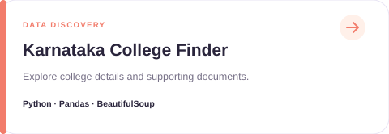

## Selected Projects

A few things I have explored and built.

## Areas I Explore

**Generative AI & RAG** · **Python Development** · **Image Processing** · **Language Applications** · **Data Discovery**

<a href="https://github.com/Sushma17J?tab=repositories"><strong>Explore all repositories →</strong></a>

