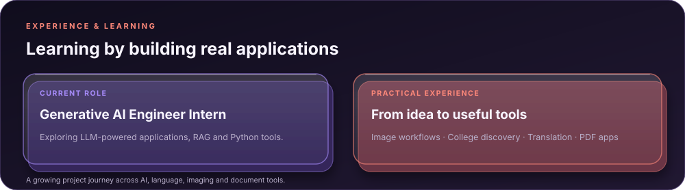
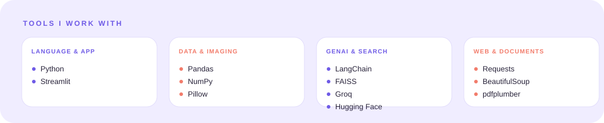
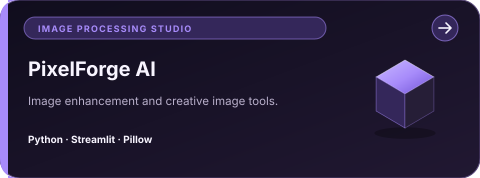
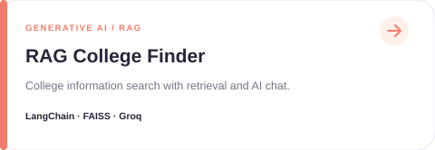
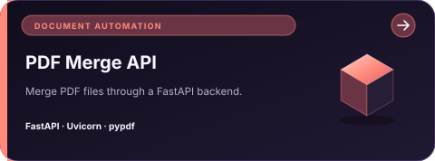

## ✦ Featured AI Projects

## ✦ More Projects

- [Loan EMI Calculator](https://github.com/Sushma17J/PragyanAI_Super30_python_Loan-Details)
- [Image Processing](https://github.com/Sushma17J/Image_Processing)
- [Image Studio](https://github.com/Sushma17J/Image_Studio)
- [Python Programs](https://github.com/Sushma17J/Python_Programs)

<a href="https://github.com/Sushma17J?tab=repositories">EXPLORE ALL PROJECTS ↗</a>

